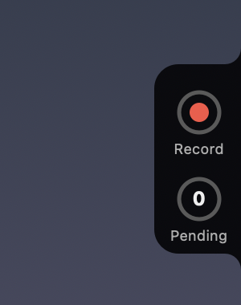

# Work Recorder

[日本語](README.ja.md) | English

**A macOS side-notch button that screen-records your manual work with your voice, so an AI agent (Claude Code, Codex...) can turn it into a reusable skill.**

<!-- demo -->
<p align="center"></p>

## Why

Explaining a task in words makes an AI misunderstand it. Showing it once, while talking, does not.
Work Recorder gives you a button on the edge of your screen: press, do the task out loud, press again. Everything - the video, a transcript of what you said, and a contact sheet of frames with timestamps - is prepared locally and laid out so an AI can read it, write the steps, and turn them into a skill.

- A black notch is docked to the edge of the screen. Move the mouse there and a **Record** button slides out.
- Pick it up with a long press to move it up/down or to the other edge. It snaps back and remembers the spot.
- Recordings stay on your Mac. Speech-to-text runs locally. Nothing is uploaded.
- Say "review my work recording" to your AI. It reads the recording, proposes how to run the task, and writes the skill.
- UI text follows your Mac language (Japanese or English).

## Requirements
- macOS 12 or later (Apple silicon or Intel)
- [Homebrew](https://brew.sh) (used to install Hammerspoon and ffmpeg)
- Python 3.9+ (included with the Xcode command line tools)
- Free disk space: ~200MB for transcription, plus a ~500MB speech model downloaded on first use (optional: `--no-transcribe`)

## Install (one line)
```bash
git clone https://github.com/nick353/work-recorder.git ~/work-recorder && ~/work-recorder/install.sh
```
Flags: `--no-transcribe` (skip speech-to-text), `--no-skill` (do not install the AI skill), `--no-open` (do not open System Settings). Running it again is safe.

Or let your AI do it: open the folder in Claude Code / Codex and say *"set up this repository"* - it follows [AGENTS.md](AGENTS.md).

Then, in **System Settings > Privacy & Security**, turn on **Hammerspoon** for:
1. **Screen Recording** (required; quit and reopen Hammerspoon afterwards)
2. **Microphone** (to record with voice)
3. **Accessibility** (optional; logs window titles)

Check everything with `./doctor.sh`.

## Use
See [docs/USAGE.md](docs/USAGE.md). In short:
1. Move the mouse to the screen edge -> click **Record** -> talk while you work -> click again (or press `ctrl+option+cmd+R`). Hold `option` while clicking to record without voice.
2. Wait for the "Recording saved" notification.
3. Tell your AI: **"review my work recording"**.

## Configuration
`config.json` (created by `install.sh` from `config.example.json`; it is git-ignored):
```json
{
  "recordings_dir": "~/Movies/WorkRecorder",
  "whisper_model": "small",
  "language": "",
  "ui_language": "auto"
}
```
| Key | Meaning |
|---|---|
| `recordings_dir` | Where recordings are stored. |
| `whisper_model` | faster-whisper model: `tiny`, `base`, `small`, `medium`, `large-v3`... |
| `language` | Speech language code (`en`, `ja`...). Empty = auto-detect. |
| `ui_language` | `ja`, `en`, or `auto` (follow macOS). |

After editing `config.json`, reload Hammerspoon (menu bar icon > Reload Config).

## Uninstall
`./uninstall.sh` removes the Hammerspoon lines and the installed skill. **Your recordings are not deleted.** Hammerspoon and ffmpeg stay (remove with `brew uninstall --cask hammerspoon`, `brew uninstall ffmpeg`).

## How it works
| Part | Role |
|---|---|
| `hammerspoon/recorder.lua` | The edge notch, drag & snap, start/stop, logging of the front app / window / Chrome URL every 2s |
| `scripts/rec-run.sh` | Keeps macOS `screencapture -v` alive until told to stop; records your voice separately with ffmpeg |
| `scripts/ingest.sh` | After stopping: shrinks the video, merges voice, calls prep |
| `scripts/prep.py` | Makes timestamped contact sheets, transcript and `MANIFEST.md` (the entry point for the AI) |
| `scripts/rec.py` | Recording ledger (pending / consulting / done / skipped) |
| `skill/SKILL.md` | How an AI turns a recording into a skill (installed for Claude Code and Codex) |

One recording folder contains `recording.mp4`, `events.jsonl` (app / window / URL timeline), `prep/` (`MANIFEST.md`, `sheets/`, `frames/`, `transcript.txt`) and `meta.json`.

## Privacy
- The whole screen is recorded, so passwords or personal data may appear. **Recordings stay on your Mac**: no network calls are made by this tool, and transcription runs locally. The first transcription downloads the speech model from Hugging Face (a one-time download of the model only).
- If you hand a recording to a cloud AI (Claude Code, Codex...), the frames and text it reads are sent to that service by that tool. Record accordingly.
- Window titles and Chrome page URLs are logged into `events.jsonl` while recording (macOS may ask for Accessibility permission for titles).

## Notes
- With an external display placed to the side, the mouse can fly past that edge. Dock the notch on the edge that has no neighbor display.
- macOS `screencapture -g` (recording with sound) can produce a broken video, so the voice is recorded separately and merged afterwards.
- `meta.json` stores the status as Japanese words (`未相談` = pending, `相談中` = consulting, `スキル化済み` = done, `見送り` = skipped). `rec.py set <id> pending|consulting|done|skipped` accepts English.

## Related
- [AI Usage Notch](https://github.com/nick353/ai-usage-notch) — a matching edge notch that shows how much of your Claude, Codex, Gemini and OpenCode limits are left.

## License
[MIT](LICENSE)
